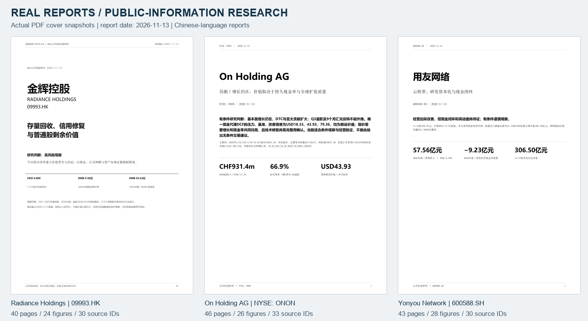

# Listed Investment Research Skill

**Evidence-led company research, financial analysis, valuation scenarios, and auditable reports for CN, HK, and US equities.**

[English](README.md) · [简体中文](README.zh-CN.md) · [Documentation](docs/index.md) · [Report gallery](docs/en/showcase.md) · [Skill entry](skills/ai-investment-research/SKILL.md)

   



This repository packages a reusable agent Skill together with its research contracts, optional report-publishing tools, documentation, and three historical report examples. It turns a request such as “research this company” into a traceable chain from official disclosures to normalized data, one explicit valuation model, an independently reviewed narrative, and actual deliverable files.

**The Skill guides an agent. It is not a standalone stock screener or an unattended live-data service.** The host supplies its model, browsing/search tools, filesystem access, and optional delegation. The bundled Python core manages workspaces, validates records, and exports supplied content; it does not discover facts or certify investment conclusions.

## What you get

| Layer | Included | Responsibility |
|---|---|---|
| Agent Skill | `ai-investment-research`, five module references, pinned upstream methods | Scope the assignment, collect evidence, analyze, challenge, and write |
| Evidence contracts | Sources, claims, forecasts, research metadata, field-level trace guidance | Preserve units, periods, provenance, assumptions, and invalidation conditions |
| Financial methods | Business-specific analysis, accounting checks, valuation and reverse valuation | Distinguish profit from cash, value from price, and forecasts from facts |
| Python core | `research.py init/check/render/doctor` | Create a run, inspect structural consistency, export Markdown/HTML/DOCX and optional browser PDF |
| Optional publisher | `publisher.py`, local chart helpers, content JSON contract | Produce white-paper PDF/HTML/Markdown with real pagination and PDF layout evidence |
| Demonstrations | Offline synthetic demo and three report snapshots | Show how the process works and what the output looks like |

The five modules are **industry, company, event, technical, and macro**. `full` selects the relevant combination; single-module and update requests remain scoped. An unsupported module is disclosed as `limited` or `skipped`, rather than filled with invented figures.

## See the output

| Historical report | Pages | Data figures | Source entries | Read |
|---|---:|---:|---:|---|
| Radiance Holdings, HKEX 09993 | 40 | 24 | 30 | [PDF](showcase/reports/radiance-09993-2026-11-13.pdf) |
| On Holding AG, NYSE ONON | 46 | 26 | 33 | [PDF](showcase/reports/on-holding-onon-2026-11-13.pdf) |
| Yonyou Network, SSE 600588 | 43 | 28 | 30 | [PDF](showcase/reports/yonyou-600588-2026-11-13.pdf) |

These are dated **2026-11-13** snapshots of author-produced, public-information research, not live recommendations, forecast-accuracy tests, or a claim that every historical source remains accessible. On uses a disclosed US intraday price and a separately dated FX reference. The gallery explains each case, published-copy provenance, and limitations. The public repository does not include the original issuer filings, raw market datasets, credentials, or internal research-session records. See [showcase notices](showcase/NOTICE.md).

## Installation

```bash
git clone git@github.com:copypasteltd/listed-investment-research-skill.git
cd listed-investment-research-skill
python skills/ai-investment-research/scripts/research.py doctor
```

The core requires **Python 3.10+ and its standard library**. A ready-to-download [v1.1.0 Skill ZIP](packages/ai-investment-research-v1.1.0.zip) and [checksum inventory](packages/ai-investment-research-v1.1.0.manifest.json) are also included. For a host that discovers skills from a directory, install the Skill folder into that host’s skill directory:

```bash
# Copy mode is the default. Existing unrelated content is never overwritten.
python skills/ai-investment-research/scripts/install.py \
  --target /absolute/path/to/your/host/skills --mode copy
```

For Codex, the parent directory is normally `~/.codex/skills`, or the `skills` directory under your configured `CODEX_HOME`. Other hosts may use a different directory or a skill-import UI. Discovery depends on the host; installing files does not provide new network tools or model credentials. Link mode and Windows installation are covered in [installation](docs/en/installation.md).

Do not copy the whole repository into a host’s skill loader. The installable unit is **`skills/ai-investment-research/`**, including its `vendor/`, scripts, references, licenses, and manifest.

## Ask the agent

```text
Use $ai-investment-research to research NYSE:ONON as of the latest information
available today. Produce a Chinese PDF with historical financial statements,
channel and regional analysis, cash-flow quality, explicit valuation scenarios,
reverse valuation, risks, and dated conditions for reassessment.
Save all research under /absolute/path/to/my-project/reports/ONON.
```

Other requests:

```text
使用 $ai-investment-research 研究 600588.SH 用友网络。
重点检查云与订阅口径、研发资本化、应收与现金流，交付完整中文PDF。

Use $ai-investment-research for a financial-quality review only.
Do not expand it into a full industry report.

Update the existing research run. Preserve the prior forecasts and evaluate
those whose validation dates have passed before adding new forecasts.
```

Set the desired language, output location, cutoff, and format in the request. The Skill defaults to Chinese but respects an explicit language. CN, HK, US, and cross-market subjects retain their own currencies, fiscal calendars, securities, and accounting boundaries.

## How the process works


1. **Fix the research boundary.** Identify the security, share classes, market, cutoff, currency, fiscal period, accounting scope, forecast horizon, and output location.
2. **Collect evidence.** Prefer regulators, exchanges, issuer reports, official statistics, and primary peer disclosures. A search result is a candidate; fetch and inspect the actual document before treating it as evidence. Network requests need bounded timeouts and honest failure reporting.
3. **Normalize and reconcile.** Keep raw documents separate from processed data. Trace material values to a source and page/table. Separate cumulative results from individual quarters, monetary units from currencies, balances from flows, and missing values from zero.
4. **Analyze the business.** Adapt the financial questions to the company: developer liquidity and asset realization, consumer brand/channel economics, or mixed software/implementation/subscription economics.
5. **Build one valuation framework.** Show assumptions, reverse-implied requirements, sensitivities, terminal dependence, cash/debt bridges, dilution, and the strongest contrary evidence. Do not label an equity cash proxy as a standard FCFF/WACC model.
6. **Review and close findings.** Preserve the finding, fix, evidence, reviewer/author attribution, and what was actually rechecked. Structural validation and independent review are different claims.
7. **Publish and follow up.** Export real files, check their contents and geometry, disclose remaining limitations, and record dated trigger/invalidation conditions for later reassessment.

The detailed [methodology](docs/en/methodology.md) and [system logic](docs/en/system-logic.md) explain decisions and exceptions rather than prescribing the same valuation to every sector.

## Workspaces and executable helpers

An explicit run directory contains the entire evidence-to-report chain:

```text
my-research-run/
├── research.json             # scope, cutoff, modules and state
├── sources.json              # source registry
├── claims.json               # facts, calculations, assumptions and inferences
├── forecasts.json            # dated validation conditions
├── 00_brief/
├── 01_sources/               # primary material; do not publish blindly
├── 02_analysis/              # scoped research modules
├── 03_models/                # data, assumptions, calculations and charts
├── 04_deliverables/          # actual reader-facing outputs
└── 99_internal/              # checks, reviews and export manifests
```

```bash
python skills/ai-investment-research/scripts/research.py init \
  --output /absolute/path/to/new-run --topic "Company research" \
  --market US --as-of 2026-11-13 --mode full \
  --horizon "industry 3 years; company 18 months; price 1–3 months" \
  --format md,html,pdf --company "NYSE:ONON On Holding AG"

# After the agent has supplied real evidence, ledgers and a written report:
python skills/ai-investment-research/scripts/research.py check \
  --run /absolute/path/to/new-run --strict
python skills/ai-investment-research/scripts/research.py render \
  --run /absolute/path/to/new-run --formats md,html,docx
```

`init` does not write a researched report. `check --strict` checks record types, references, dates, limitations, paths, and related consistency; **a passing result does not establish the truth of a source, model, or recommendation**. Unknown publication dates and technical targets may remain explicit warnings.

For the richer paginated PDF layout, prepare the documented content JSON and use the optional publisher:

```bash
python -m pip install -r skills/ai-investment-research/requirements-report.txt
python skills/ai-investment-research/scripts/publisher.py \
  --run /absolute/path/to/new-run --content 99_internal/content.json \
  --font-body /absolute/path/to/body.ttf \
  --font-head /absolute/path/to/heading.ttf
```

The publisher is offline and content-only. It uses local PNG/JPEG charts, escapes supplied text, embeds chart data in standalone HTML, writes real PDF bookmarks and source links, and reports actual pagination. Fonts must be legally available locally; no proprietary font is bundled. `AIR_FONT_BODY` and `AIR_FONT_HEAD` are also supported. See [publishing](docs/en/publishing.md).

## Try it without market data

```bash
# No API key, network call, model invocation or third-party package required.
python tools/demo.py --output /absolute/path/to/new-synthetic-run

# Optional PDF, after installing report dependencies and compatible local fonts:
python tools/demo.py --output /absolute/path/to/new-synthetic-pdf --pdf \
  --font-body /absolute/path/to/body.ttf --font-head /absolute/path/to/heading.ttf
```

The demo labels every value as **synthetic**. It exercises the evidence/check/export path; it does not simulate investment performance. See [examples](examples/README.md).

## Design decisions and limits

- **One company, one valuation contract.** Industry summaries reference that model. Technical levels and event scenarios are not averaged into fair value or an “upside probability.”
- **Cash definitions stay visible.** IFRS lease principal and cash interest, capitalized development, restricted cash, financial products, and share-based compensation require explicit treatment to avoid double counting.
- **No hidden zero fill.** Missing subscription revenue, share data, project liquidity, or source dates remain gaps. A quarterly balance is not a year-to-date expense.
- **Evidence cutoff is not the download date.** A document downloaded later can only support an earlier view if it was already available at the cutoff.
- **No performance claim.** These reports demonstrate research and publishing, not predictive accuracy or returns.
- **No trading or external publication by default.** Research authorization does not authorize transactions, account changes, emails, or uploading a user’s research. This repository was published through a separate explicit instruction.
- **Geometry is not visual judgment.** PDF bounds, embedded images, extracted Chinese text, and bookmarks can be checked deterministically. If no image-capable model or human reviewed the layout, that limitation remains disclosed.

## Documentation map

| Topic | English | 中文 |
|---|---|---|
| Installation and portability | [Installation](docs/en/installation.md) | [安装与迁移](docs/zh-CN/installation.md) |
| End-to-end use and commands | [Usage](docs/en/usage.md) | [使用逻辑](docs/zh-CN/usage.md) |
| Research methodology | [Methodology](docs/en/methodology.md) | [方法论](docs/zh-CN/methodology.md) |
| States, modules and flow | [System logic](docs/en/system-logic.md) | [系统逻辑](docs/zh-CN/system-logic.md) |
| Evidence and content schemas | [Data contracts](docs/en/data-contracts.md) | [数据合同](docs/zh-CN/data-contracts.md) |
| PDF and export behavior | [Publishing](docs/en/publishing.md) | [报告出版](docs/zh-CN/publishing.md) |
| Checks and limitations | [Quality](docs/en/quality-and-limits.md) | [质量与限制](docs/zh-CN/quality-and-limits.md) |
| Historical report examples | [Showcase](docs/en/showcase.md) | [案例展示](docs/zh-CN/showcase.md) |
| Common problems | [FAQ](docs/en/faq.md) | [常见问题](docs/zh-CN/faq.md) |

## Development and packaging

```bash
python -B -m unittest discover -s skills/ai-investment-research/scripts -p "test_*.py" -v
python tools/verify_repo.py
python tools/build_package.py --output dist
```

The package builder creates a versioned Skill-only ZIP and SHA-256 manifest. Generated runs, environments, caches, and local configuration do not belong in source control. See [contributing](CONTRIBUTING.md), [release notes](CHANGELOG.md), and the [validation record](docs/validation.md) for what was actually executed.

## Attribution and license

Original integration code and documentation are MIT licensed. The bundle retains five selected upstream Skills from three pinned repositories:

| Upstream | Included methods | License |
|---|---|---|
| [Anthropic financial-services](https://github.com/anthropics/financial-services) | Sector overview | Apache-2.0 |
| [TraderMonty claude-trading-skills](https://github.com/tradermonty/claude-trading-skills) | Event scenarios, technical analysis, macro regimes | MIT |
| [rollingSirius equity-research-skill](https://github.com/rollingSirius/equity-research-skill) | Company research and valuation | MIT |

See [LICENSE](LICENSE), [third-party notices](THIRD_PARTY_NOTICES.md), the [pinned source manifest](skills/ai-investment-research/upstream-manifest.json), and [showcase notices](showcase/NOTICE.md). Source-code licenses do not grant market-data redistribution rights, paid APIs, model credentials, or rights to proprietary fonts. This is an independent integration, not an endorsement by the upstream authors or issuers.
