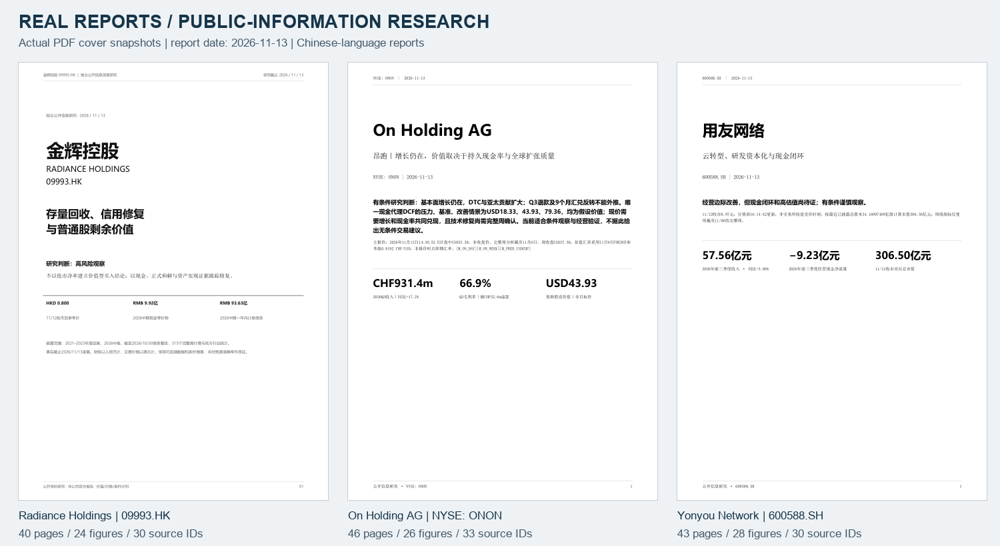

# 上市公司投研 Skill

**面向 A 股、港股与美股，以证据为基础，整合行业、财报质量、估值情景及可追溯报告交付。**

[简体中文](README.zh-CN.md) · [English](README.md) · [文档导航](docs/index.md) · [报告展示](docs/zh-CN/showcase.md) · [Skill 入口](skills/ai-investment-research/SKILL.md)

   



本仓库封装可安装的 `ai-investment-research` Skill、研究方法与逻辑文档、可选图表/PDF工具，以及三份历史报告展示。它帮助智能体把“研究某家公司”推进为完整链路：**任务边界 → 官方资料 → 可追溯数据 → 财务判断 → 唯一主估值 → 复核修订 → 成品报告 → 前瞻验证**。

**它是智能体研究技能，不是独立运行的自动荐股或实时数据平台。** 模型、搜索/浏览、文件工具及可选子代理由宿主提供；Python 核心负责工作区、结构校验及已有内容导出，不会自动获取财报事实，也不认证投资结论。

## 交付了什么

| 层次 | 内容 | 实际职责 |
|---|---|---|
| 智能体 Skill | 统一入口、五模块、固定上游方法 | 明确任务，收集证据，分析与反证，撰写报告 |
| 证据合同 | 来源、结论、前瞻、研究状态、逐数溯源 | 记录来源、期间、单位、假设及失效条件 |
| 分析方法 | 按业务适配财报、现金、估值与反向估值 | 分开利润与现金、价值与价格、事实与预测 |
| Python 核心 | `research.py init/check/render/doctor` | 初始化、检查记录、导出MD/HTML/DOCX及可选浏览器PDF |
| 可选出版工具 | `publisher.py`、图表辅助、内容JSON | 白底黑字商务PDF、独立HTML、真实分页与版面证据 |
| 示例与展示 | 合成离线演示、三份历史研究成品 | 可复现流程，直接查看结果形态 |

五个研究模块为：**行业 industry、公司 company、事件 event、技术 technical、宏观 macro**。完整研究按题目组合；单模块请求保持原范围。缺少资料或能力时明确标记 `limited` 或 `skipped`，不为填满章节编造数字。

## 先看成品

| 历史样本 | 页数 | 数据图 | 来源条目 | 阅读 |
|---|---:|---:|---:|---|
| 金辉控股，HKEX 09993 | 40 | 24 | 30 | [PDF](showcase/reports/radiance-09993-2026-11-13.pdf) |
| On Holding AG，NYSE ONON | 46 | 26 | 33 | [PDF](showcase/reports/on-holding-onon-2026-11-13.pdf) |
| 用友网络，SSE 600588 | 43 | 28 | 30 | [PDF](showcase/reports/yonyou-600588-2026-11-13.pdf) |

以上是 **2026-11-13 的自制公开信息研究快照**，用于展示分析与出版能力，不是实时建议、预测准确率回测或来源持续可达保证。On 使用注明时点的美股盘中价格及另一日期的参考汇率。仓库不收录这三项研究的原始公司公告、原始行情、凭据或内部会话记录；发布副本的来源、哈希与限制见[案例展示](docs/zh-CN/showcase.md)及[展示声明](showcase/NOTICE.md)。

## 安装

```bash
git clone git@github.com:copypasteltd/listed-investment-research-skill.git
cd listed-investment-research-skill
python skills/ai-investment-research/scripts/research.py doctor
```

核心仅需 **Python 3.10+ 标准库**。也可直接下载 [v1.1.0 Skill ZIP](packages/ai-investment-research-v1.1.0.zip) 和[校验清单](packages/ai-investment-research-v1.1.0.manifest.json)。对通过技能目录加载 Skill 的宿主，可把技能安装到其目录：

```bash
# 默认复制；遇到不同的既有目录不会覆盖。
python skills/ai-investment-research/scripts/install.py \
  --target /absolute/path/to/your/host/skills --mode copy
```

Codex 通常使用 `~/.codex/skills` 或配置的 `CODEX_HOME` 下 `skills`；其他宿主可能有不同目录或导入界面。**安装单位是 `skills/ai-investment-research/` 整个目录**，不是仓库根目录，也不是单个入口文件。安装文件不会给宿主增加网络工具或模型凭据。链接模式、Windows与字体配置见[安装与迁移](docs/zh-CN/installation.md)。

## 如何调用

```text
使用 $ai-investment-research 研究 600588.SH 用友网络。
截止日采用当前实际可知时点，重点分析云/订阅定义、研发资本化、
应收回款、财报质量、未来估值与风险。生成完整中文PDF及数据图。
所有材料保存到 /absolute/path/to/my-project/reports/600588。
```

```text
Use $ai-investment-research to research NYSE:ONON.
Analyze channels, regions, inventory, currency effects, cash flow and valuation.
Produce a Chinese PDF with explicit assumptions and reassessment conditions.
```

```text
只做财报质量专项，不扩成全行业研究。

更新已有运行：保留旧预测，先评估已经到期的验证条件，再增加新判断。
```

在请求中指定语言、目录、截止日、期限和格式即可。默认中文，尊重显式语言。跨市场研究分别保留证券、币种、财年、股权和会计范围，不能拼接为虚构的同口径时间序列。

## 方法论与使用逻辑


1. **固定对象和口径。** 核验上市地、代码、股权类别、经济权益、截止日、财年、币种、合并范围、预测期限和输出目录。
2. **先取一手资料。** 优先监管、交易所、公司、统计机构及同业正式披露；搜索命中只是候选，读取原文后才进入证据。请求有超时边界，抓取失败如实记录。
3. **逐数溯源并复算。** 原始资料和加工数据分开；重要数字保留源ID与页码/表格。累计与单季、币种与金额单位、余额与流量、缺失与零分别处理。
4. **按业务分析。** 开发商优先现金、债务与资产实现；消费品牌分析量价、渠道、地区、库存与租赁；混合软件企业区分订阅、许可、实施、ARR、资本化和收款。
5. **维护唯一估值合同。** 明确增长、现金率、折现/回报要求、终值、现金债务桥与稀释；通过反向估值和敏感性暴露要求，不把股权现金代理称为标准FCFF/WACC。
6. **复核与闭环。** 记录发现、修改、来源、确认人及实际复验范围；独立复验、负责人确认和结构通过分开，不互相替代。
7. **真实导出与后续验证。** 生成存在的文件，核对中文、图表、分页、书签和剩余限制；前瞻有基准、期限、触发、失效与验证日期。

详细规则见[方法论](docs/zh-CN/methodology.md)与[系统逻辑](docs/zh-CN/system-logic.md)。不要求所有行业套同一模型，也不要求无关模块为凑齐而运行。

## 工作区与执行命令

```text
my-research-run/
├── research.json             # 对象、截止、模块和状态
├── sources.json              # 来源注册
├── claims.json               # 事实、计算、假设、推断
├── forecasts.json            # 可复盘前瞻
├── 00_brief/
├── 01_sources/               # 原文资料；不要未经筛选发布
├── 02_analysis/              # 各模块分析
├── 03_models/                # 数据、假设、模型与图表
├── 04_deliverables/          # 实际读者成品
└── 99_internal/              # 检查、复核与导出记录
```

```bash
python skills/ai-investment-research/scripts/research.py init \
  --output /absolute/path/to/new-run --topic "公司深度研究" \
  --market CN --as-of 2026-11-13 --mode full \
  --horizon "行业3年；公司18个月；价格1—3个月" \
  --format md,html,pdf --company "600588.SH 用友网络"

# 智能体完成真实取证、台账和报告正文后：
python skills/ai-investment-research/scripts/research.py check \
  --run /absolute/path/to/new-run --strict
python skills/ai-investment-research/scripts/research.py render \
  --run /absolute/path/to/new-run --formats md,html,docx
```

`init` 不会自动写出真实研报。`check --strict` 检查结构、日期、引用、路径与限制披露，**通过不代表来源真实、估值正确或具备投资收益**。未知发布时间、技术目标非价值证明等提示会如实保留。

更完整的分页 PDF 使用独立内容 JSON 和可选出版器：

```bash
python -m pip install -r skills/ai-investment-research/requirements-report.txt
python skills/ai-investment-research/scripts/publisher.py \
  --run /absolute/path/to/new-run --content 99_internal/content.json \
  --font-body /absolute/path/to/body.ttf \
  --font-head /absolute/path/to/heading.ttf
```

出版器离线读取已有内容，仅嵌入运行内 PNG/JPEG；文字转义、HTML内嵌图片、PDF实际页码、书签与来源链接均可核查。字体必须由使用者合法提供，也支持 `AIR_FONT_BODY` / `AIR_FONT_HEAD`；仓库不分发系统版权字体。见[报告出版](docs/zh-CN/publishing.md)。

## 无数据账号也能验证流程

```bash
# 无网络请求、API密钥或模型调用；核心仅需标准库。
python tools/demo.py --output /absolute/path/to/new-synthetic-run

# 安装可选报告依赖及字体后生成合成PDF：
python tools/demo.py --output /absolute/path/to/new-synthetic-pdf --pdf \
  --font-body /absolute/path/to/body.ttf --font-head /absolute/path/to/heading.ttf
```

示例中的数值全部标为 **synthetic / 合成**，只证明证据合同与导出链路可运行，不用于展示真实投资结论或预测准确率。详见[示例说明](examples/README.md)。

## 为什么这样设计

- **价值、价格路径与事件不混。** 行业摘要引用公司唯一主估值；技术价位与事件情景不平均成合理价值或上涨概率。
- **现金定义显式。** IFRS租赁本金/利息、资本化研发、受限现金、理财与SBC分别处理，避免重复扣减或重复计值。
- **缺数不补零。** 缺少纯订阅收入、项目可用现金或债务细分，就披露缺口；期末余额不能冒充本期费用。
- **截止日独立于抓取日。** 后下载的旧资料只有在原截止日前已发布，才能用于当时视角；不使用事后信息回看预测。
- **不承诺命中率。** 三份成品证明研究与出版实践，不是收益或预测能力的统计验证。
- **研究不附带交易/外发授权。** 不默认下单、改账户、发邮件或上传用户研究；本仓库发布来自另行明确授权。
- **结构检查不等于目视验收。** 可确定性核查PDF边界、图片、文本和书签；缺少图像模型或人工审阅时明确视觉未查。

## 完整文档体系

| 主题 | 中文 | English |
|---|---|---|
| 安装与可迁移性 | [安装](docs/zh-CN/installation.md) | [Installation](docs/en/installation.md) |
| 操作和命令 | [使用逻辑](docs/zh-CN/usage.md) | [Usage](docs/en/usage.md) |
| 分析方法 | [方法论](docs/zh-CN/methodology.md) | [Methodology](docs/en/methodology.md) |
| 模块、状态、数据流 | [系统逻辑](docs/zh-CN/system-logic.md) | [System logic](docs/en/system-logic.md) |
| 台账和内容结构 | [数据合同](docs/zh-CN/data-contracts.md) | [Data contracts](docs/en/data-contracts.md) |
| PDF/HTML/Word | [出版](docs/zh-CN/publishing.md) | [Publishing](docs/en/publishing.md) |
| 验证与边界 | [质量与限制](docs/zh-CN/quality-and-limits.md) | [Quality](docs/en/quality-and-limits.md) |
| 成品案例 | [展示](docs/zh-CN/showcase.md) | [Showcase](docs/en/showcase.md) |
| 常见问题 | [FAQ](docs/zh-CN/faq.md) | [FAQ](docs/en/faq.md) |

## 开发与封装

```bash
python -B -m unittest discover -s skills/ai-investment-research/scripts -p "test_*.py" -v
python tools/verify_repo.py
python tools/build_package.py --output dist
```

打包器生成仅含 Skill 的版本化ZIP及SHA-256清单。研究运行、虚拟环境、缓存和本机配置不进入Git。实际执行过的验证范围见[验收记录](docs/validation.md)，维护要求见[贡献说明](CONTRIBUTING.md)和[更新记录](CHANGELOG.md)。

## 上游、许可证与权利边界

整合层原创代码与文档采用MIT；保留三个固定提交仓库中的五个上游Skill：

| 上游 | 方法组成 | 许可证 |
|---|---|---|
| [Anthropic financial-services](https://github.com/anthropics/financial-services) | 行业概览 | Apache-2.0 |
| [TraderMonty claude-trading-skills](https://github.com/tradermonty/claude-trading-skills) | 事件情景、技术、宏观 | MIT |
| [rollingSirius equity-research-skill](https://github.com/rollingSirius/equity-research-skill) | 公司研究与估值 | MIT |

详见[LICENSE](LICENSE)、[第三方声明](THIRD_PARTY_NOTICES.md)、[固定源清单](skills/ai-investment-research/upstream-manifest.json)及[展示声明](showcase/NOTICE.md)。代码许可不授予行情再分发、付费API、模型额度或字体版权。本项目为独立整合，不代表上游作者、数据商或上市公司背书。
