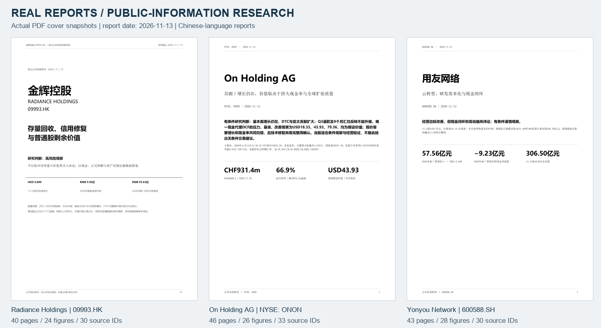
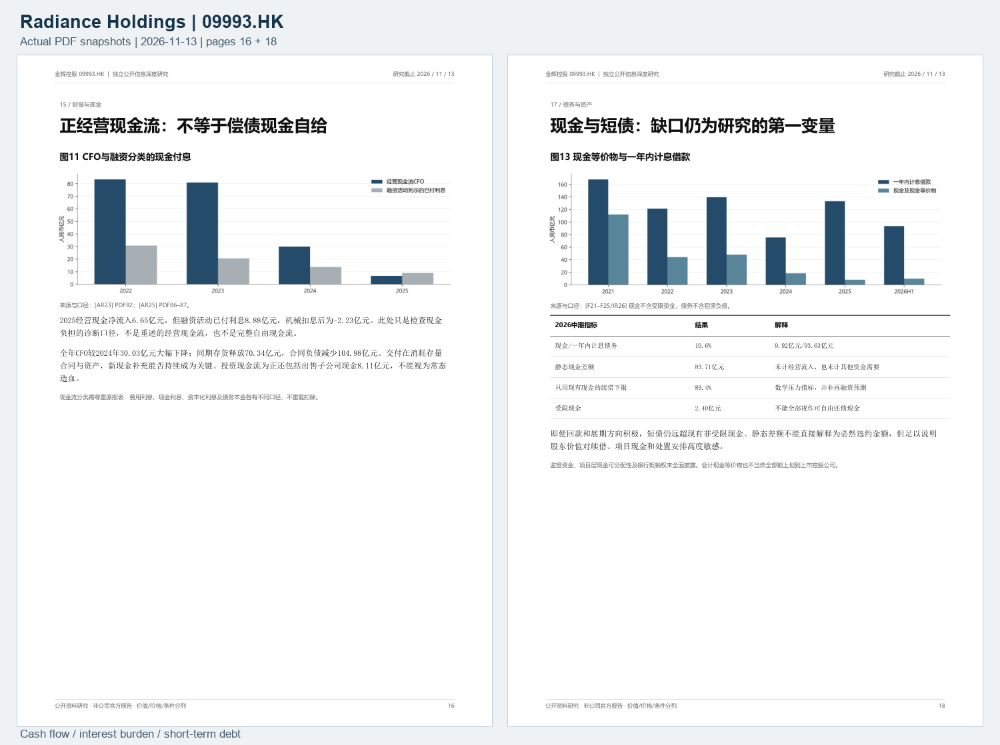
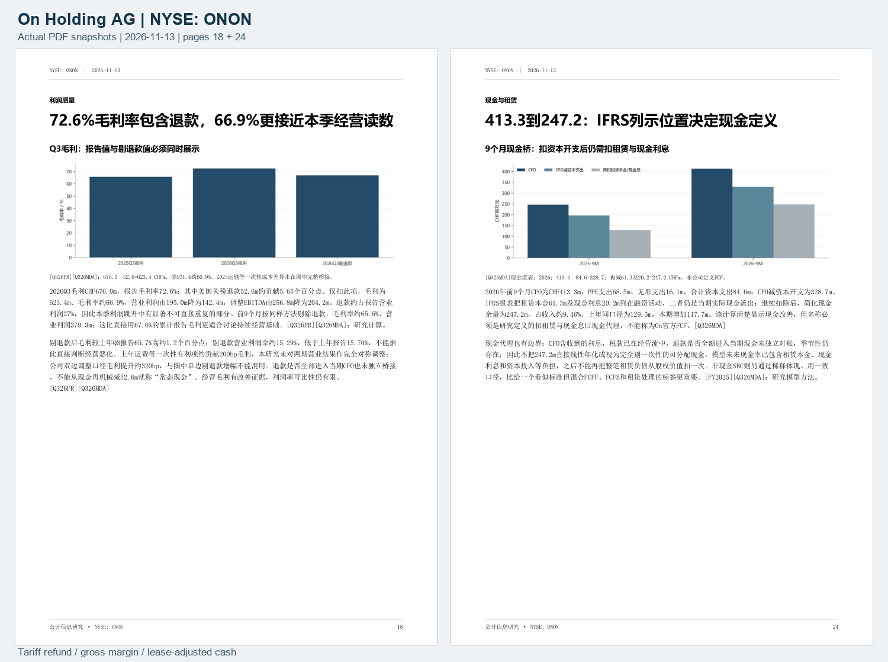
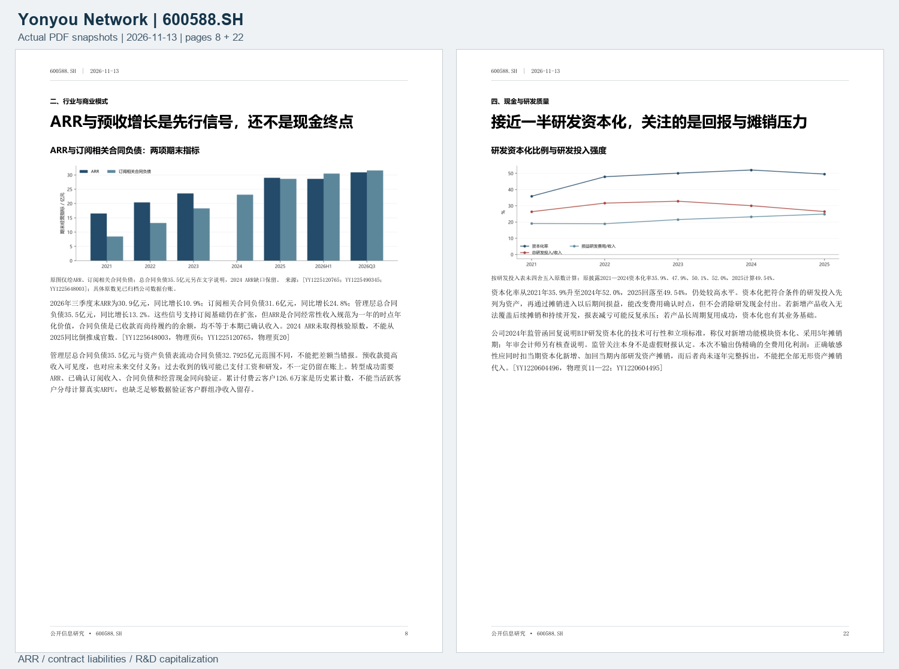

# Three markets, three completed research reports

[简体中文](../zh-CN/showcase.md) · [Files and checksums](../../showcase/manifest.json) · [Rights and usage notice](../../showcase/NOTICE.md)

These completed, author-created Chinese-language reports use public information to examine a Hong Kong property developer, a US-listed sportswear brand, and a mainland Chinese enterprise software company. All three carry the report date **2026-11-13**. They show how industry research, accounting, cash conversion, valuation assumptions, and conditional follow-up can become a concrete research document.

**These are historical output examples, not live recommendations or a backtest of forecast accuracy.** Publication checks covered files, privacy, page counts, and source identifiers. The historical financial figures and cited facts were not independently reverified online for this showcase release. Read them within their original snapshot and verify current disclosures and prices before making any real decision.

*Actual PDF snapshots: page 1 of each report, rendered in full and arranged side by side. No AI-generated decorative image is used. Open the PDFs for readable text; the reports are in Chinese, with bilingual showcase documentation.*

| Completed case | Market | Pages / figures / source IDs | Open |
| --- | --- | --- | --- |
| Radiance Holdings / 金辉控股 | 09993.HK · Hong Kong | 40 / 24 / 30 | [Full PDF](../../showcase/reports/radiance-09993-2026-11-13.pdf) · [Analysis preview](../../showcase/images/radiance-09993-detail-preview.png) |
| On Holding AG / On 昂跑 | ONON · NYSE | 46 / 26 / 33 | [Full PDF](../../showcase/reports/on-holding-onon-2026-11-13.pdf) · [Analysis preview](../../showcase/images/on-holding-onon-detail-preview.png) |
| Yonyou Network / 用友网络 | 600588.SH · Shanghai | 43 / 28 / 30 | [Full PDF](../../showcase/reports/yonyou-600588-2026-11-13.pdf) · [Analysis preview](../../showcase/images/yonyou-600588-detail-preview.png) |

Page counts come from the actual PDFs. Figure counts were checked against image-bearing analysis pages; source counts use unique appendix IDs. A disclosure may have multiple IDs for different uses, so these counts do not measure independent corroboration.

## Radiance Holdings: cash and debt before residual equity

This case demonstrates scope discipline in property research. Revenue recognized on delivery differs from new contracted sales; positive operating cash flow differs from cash available for debt service; consolidated equity differs from the value attributable to ordinary shareholders. The report separates cash-interest classification, restricted cash, debt extensions, non-controlling interests, and the allocation of asset losses before interpreting a low price-to-book ratio.

Three useful lessons are to read interest paid within financing cash flows alongside CFO, describe a static cash gap as a stress indicator rather than an inevitable default amount, and keep the listed group separate from its domestic, partly owned subgroup when comparing periods and accounting standards.

*Actual PDF snapshots: page 16, operating cash flow and cash interest; page 18, cash and short-term debt. The original text, charts, and citations are retained.*

[Read the full Radiance Holdings report](../../showcase/reports/radiance-09993-2026-11-13.pdf). Its quote is a post-close vendor snapshot from 2026-11-12. Completed weekly bars end on 2026-11-06. The report's HKMA FX reference has an observation date of 2026-10-31 and is not contemporaneous spot FX.

## On Holding AG: separate growth, exceptional profit, and shareholder cash

This case connects brand, DTC, geographic, and product growth with earnings quality and cash conversion. It treats the Q3 tariff refund, year-to-date foreign-exchange reversal, and ongoing operating performance separately. CHF accounts, USD market prices, and the economic rights of the A/B share classes have distinct roles. The research cash proxy deducts capital expenditure, lease principal, and cash interest, with an explicit definition and valuation limitations.

Three useful lessons are to show reported and refund-adjusted gross margins together without implying a fully symmetric comparison, inspect lease and interest classifications in the IFRS cash-flow statement, and distinguish a valuation assumption from a future market-price path.

*Actual PDF snapshots: page 18, the reported 72.6% versus refund-adjusted 66.9% gross margin; page 24, the 413.3-to-247.2 cash bridge. These figures belong to the historical report snapshot and were not newly verified as live data for this release.*

[Read the full On Holding AG report](../../showcase/reports/on-holding-onon-2026-11-13.pdf). The main quote is **intraday at 14:30:52 EST on 2026-11-12**, not that day's close. Weekly analysis uses completed bars only through **2026-11-06**. The FX input is the **2026-11-06 FRED historical reference**, not FX observed at the intraday quotation time.

## Yonyou Network: test the cloud transition through R&D and cash

This case connects cloud revenue, subscriptions, ARR, contract liabilities, and cash collection while separating current R&D resources, new capitalization, accumulated assets, and subsequent amortization. Revenue recovery and narrowing losses are assessed alongside continuing development costs, receivables, contract assets, financing, and the conditions needed to support valuation.

Three useful lessons are that ARR is an annualized point-in-time measure rather than recognized period revenue, contract liabilities also represent future delivery obligations and do not prove the cash remains on hand, and R&D capitalization changes expense timing without removing cash outlays. A precise fully expensed profit sensitivity cannot be manufactured when internally developed asset amortization has not been separately identified.

*Actual PDF snapshots: page 8, ARR and subscription-related contract liabilities; page 22, R&D capitalization, economic returns, and amortization.*

[Read the full Yonyou Network report](../../showcase/reports/yonyou-600588-2026-11-13.pdf). Its price comes from a 2026-11-12 post-close vendor snapshot; 16:14:42 is the vendor update time. Weekly indicators use completed bars only through 2026-11-06.

## Using the examples

Use the reports to study structure, attribution, accounting checks, explicit assumptions, risks, and conditions that can invalidate a thesis. Scenario values, conditional price levels, and review dates remain part of the original research snapshot. The repository makes no claim of win rate, investment return, forecast accuracy, or completed future validation.

The public showcase includes three original research reports, rendered page previews, bilingual explanations, a checksum manifest, and a rights notice. It does not include original corporate filings, raw market feeds, complete datasets or model files, internal reviews, or execution logs. A few private process labels were neutralized in publication copies; original reports remain unchanged. Compare source-original and published-copy SHA-256 values in the [manifest](../../showcase/manifest.json).

Original report prose and author-created charts are offered under the repository MIT license to the extent the authors hold the rights. This does not license underlying market data, quoted disclosures, company branding, or font software under MIT. Source links are retained. See the [rights and usage notice](../../showcase/NOTICE.md).
