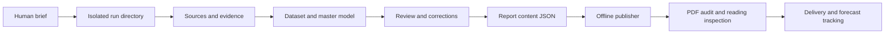

# System logic and state flow

[English README](../../README.md) · [Documentation index](../index.md) · [中文](../zh-CN/system-logic.md)

Research and publishing are separate, inspectable stages: the researcher owns evidence and models; the publisher lays out completed content and audits the result.
The portable package combines five upstream skills from three pinned repositories and retains their licenses; the integration release is 1.1.0.
See [Research methodology](methodology.md) for analytical rules and [Data contracts](data-contracts.md) for fields and commands.

## 1. The main chain

Arrows represent prerequisites; the diagram does not require a different agent at every step.
A factual or modeling finding returns to the relevant evidence or model, followed by synchronized prose and a new publication build.
A pagination issue returns to content organization or publisher configuration; the publisher does not repair investment conclusions.
After delivery, review forecasts on their original dates and conditions and create a new version for updates.

## 2. Host and Python responsibilities

The model host reads the skill, interprets the task, finds and reads evidence, forms judgments, writes content, and coordinates review.
The host supplies search and fetch capabilities when available; offline research is bounded by supplied and retained materials.
Credentials belong in the host's secure configuration. The release bundles no market-data account, model key, or automatic login setup.

The [core script](../../skills/ai-investment-research/scripts/research.py) uses the Python standard library for workspaces, record checks, and basic document export.
`doctor` detects availability; `init` creates directories and empty ledgers; `check` validates structure; `render` consumes authored Markdown.
These commands do not fetch filings, call a model, create facts, or turn a successful initialization into a completed report.
`init --output` requires an explicit absolute directory; output preferences guide the agent and are not a CLI mechanism for reading a personal path.
An existing valid run can be resumed; an existing non-run directory is rejected. Historical research should receive a new version.

The [standalone publisher](../../skills/ai-investment-research/scripts/publisher.py) reads run-local content JSON and PNG/JPEG files and produces PDF, Markdown, HTML, and audits offline.
It needs optional report dependencies and available fonts; a standard-library core does not imply dependency-free PDF publishing.
Installation, offline demonstration, and packaging tools support distribution rather than a live automatic research service.

## 3. A run directory is the recovery boundary

| Location | Responsibility |
| --- | --- |
| `00_brief/` | Brief, scope, assumptions, and gaps |
| `01_sources/raw/` | Raw evidence; other source subdirectories may be organized for the run |
| `02_analysis/` | Industry, company, event, technical, and macro results |
| `03_models/` | Normalized data, master assumptions, reproducible models, and charts |
| `04_deliverables/` | Reading artifacts that actually exist |
| `99_internal/` | Content JSON, review records, checks, and publication audits |
| Four root JSON ledgers | Shared contracts for run state, sources, claims, and forecasts |

Paths stored in contracts are relative to the run. Resolved content and image paths must remain inside it, including after symlink resolution.
Export does not delete raw evidence, and model outputs must not be represented as original disclosures.
Recover from run state, the brief, and actual artifacts rather than conversation memory alone.
Completed artifacts must correspond to the current content hash; a stale audit cannot prove a new build succeeded.

## 4. Research state and publication state are independent

Modules retain five fixed keys in the [run-state contract](data-contracts.md), each with `status / reason / artifact`.

| Module state | Meaning | Required record |
| --- | --- | --- |
| `pending` | Unfinished | Keep the open work visible rather than presenting a conclusion |
| `complete` | Completed within its agreed boundary | Reference a real module artifact |
| `limited` | Evidence or capability is missing, but a bounded result exists | Explain the reason and effect in the report |
| `skipped` | Inapplicable to this question | State why it does not apply |

The overall run uses `draft / complete / limited`; these are distinct from module states.
`full` records the requested research scope. An unfinished applicable module cannot become completed research merely because export succeeded.
A genuinely inapplicable technical or macro module can be skipped with a reason rather than padded with empty sections.

| Publication audit state | CLI exit | Meaning |
| --- | --- | --- |
| `pass` | 0 | Implemented layout checks passed for this build |
| `warning` | 0 | A build exists with real warnings that must be read, addressed, or disclosed |
| `fail` | 2 | The audit failed; this is not a publication that passed its gate |
| Input/build exception | 1 | Read the error; an existing manifest is not evidence of this attempt succeeding |

A `limited` research run can have a layout `pass`; `complete` research can encounter a publication `fail`.
Page counts, hashes, and geometric checks do not establish factual truth, model suitability, or forecast reliability.

## 5. Parallel roles and dependencies

Industry structure, company collection, a defined event, independent technical analysis, and macro context can run in parallel with clear boundaries.
Valuation-method selection depends on business classification and consistent data; synthesis depends on reconciliation, and prose depends on a frozen master model.
Each assignment specifies subject, market, cutoff, currency, writable directory, questions, artifacts, and evidence to return.
Stage module additions locally and let the lead assign stable shared IDs rather than allowing competing writes to the common ledgers.

Roles may include lead researcher, extractor, modeler, and independent reviewer; no particular agent framework is mandatory.
Without child agents, follow the same dependency order and label review as self-review rather than an independent second opinion.
Maintain one effective version of shared facts and master valuation; repeated wording does not increase the evidence count.
A correction record identifies the finding, impact, changed location, and acceptance status. “Changed” alone does not mean rechecked.

## 6. Shared content and actual pagination

Core `render` exports Markdown to HTML/DOCX and attempts PDF printing through an installed browser.
The standalone publisher generates Markdown, standalone HTML, and PDF from one content JSON: prose, tables, chart notes, and sources share that input.
Both routes can write the same reading filenames. Choose the intended final route and use the audit for the final build.
The standalone publisher does not execute arbitrary HTML, fetch missing charts, or invent citation relationships.

Input `pages` are logical pages, not a promise that each item occupies one physical PDF page.
The cover is one page and `planned_pages = 1 + len(pages)`; long body content may flow onto additional pages.
Final PDF inspection supplies actual page counts and each logical item's start/end mapping. A planned/actual mismatch produces at least a `warning`.
Long tables split by row with repeated headers; an oversized row or chart group fails explicitly instead of shrinking text into illegibility.

A visible contents page uses `type: "toc"` and `blocks: []`; entries come from actual starting pages.
The publisher allows up to six layout passes to converge. It fails if convergence is impossible and cannot repair hand-typed page numbers in prose.
Bookmarks and section starts use the actual mapping; PDF page references in Markdown/HTML use that mapping too.
HTML embeds local image bytes as data URIs for single-file offline reading; original image bytes are retained.

## 7. The delivery gate

Retain separate evidence for scope and gap disclosure, correction status, core structural checks, and the publication audit.
Open at least one real reading artifact to inspect fonts, tables, chart notes, links, and pagination; list a PDF only when it exists.
When visual inspection was unavailable, say so; text-box audits and hashes are not visual acceptance.
Deliver key conclusions, cutoff, principal artifacts, and material limitations, while retaining sources and original forecasts for later review.
Synthetic offline examples verify software entry points and publishing; historical research snapshots illustrate corrections. Neither is live investment advice.
