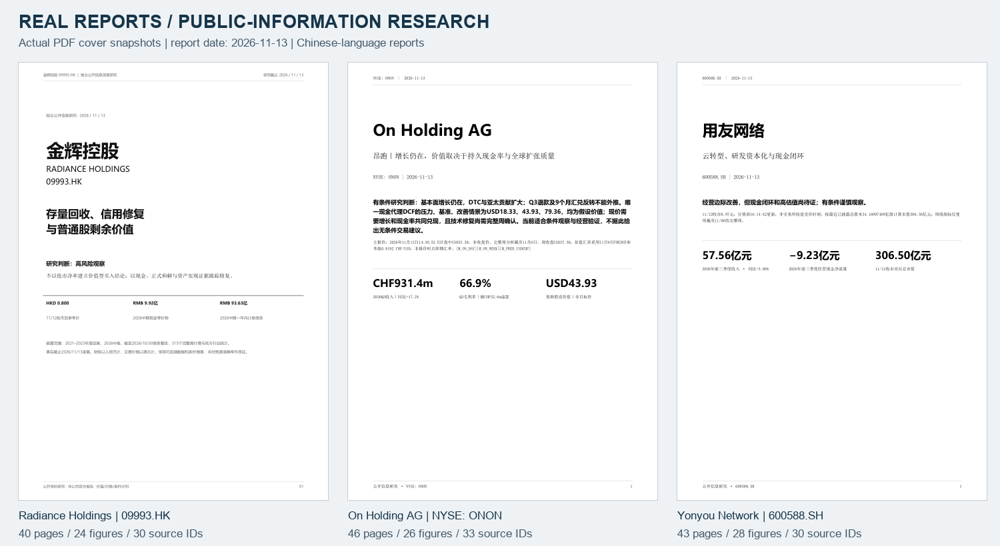
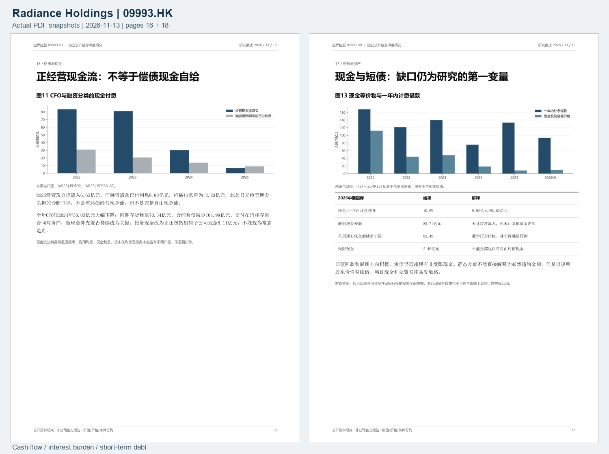
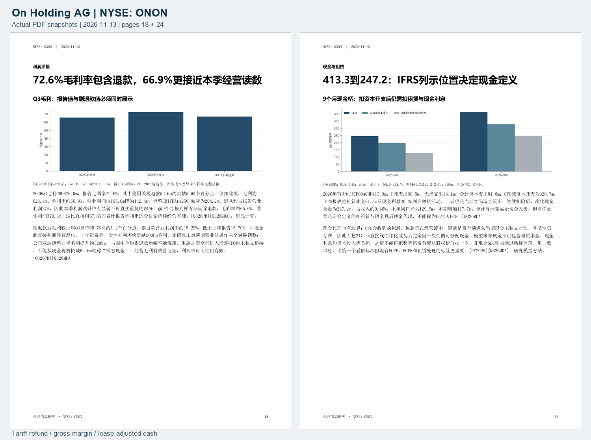
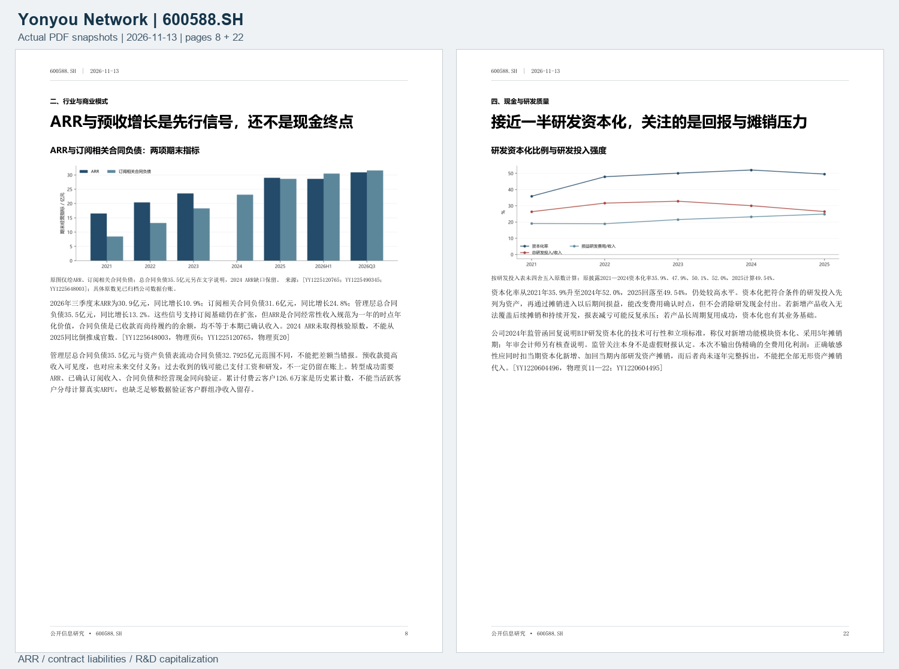

# 三个市场，三份已完成的研究报告

[English](../en/showcase.md) · [文件与校验清单](../../showcase/manifest.json) · [版权与使用说明](../../showcase/NOTICE.md)

这些是作者基于公开信息制作、已完成的中文深度投研报告，分别覆盖香港上市房地产企业、美国上市运动品牌和 A 股企业软件公司。报告日期统一为 **2026-11-13**；这里保留当时的研究内容，展示行业、会计、现金、估值和条件验证如何落到具体报告中。

**它们是历史成果展示，不是实时推荐，也不是预测准确率回测。** 本次发布检查了文件、隐私、页数与来源标识，未重新联网逐项核验历史财务数字和引用事实。阅读时应按原报告快照理解，并在任何实际决策前重新核对最新公告和行情。

*真实 PDF snapshot：各报告第 1 页，按原页完整渲染后并排展示。没有使用 AI 装饰图；小图用于浏览，正文请打开 PDF。三份报告均为中文，展示说明提供中英双语。*

| 已完成案例 | 市场 | 页数 / 数据图 / 来源 ID | 阅读入口 |
| --- | --- | --- | --- |
| 金辉控股 / Radiance Holdings | 09993.HK · 香港 | 40 / 24 / 30 | [完整 PDF](../../showcase/reports/radiance-09993-2026-11-13.pdf) · [分析页预览](../../showcase/images/radiance-09993-detail-preview.png) |
| On Holding AG / On 昂跑 | ONON · NYSE | 46 / 26 / 33 | [完整 PDF](../../showcase/reports/on-holding-onon-2026-11-13.pdf) · [分析页预览](../../showcase/images/on-holding-onon-detail-preview.png) |
| 用友网络 / Yonyou Network | 600588.SH · 上海 | 43 / 28 / 30 | [完整 PDF](../../showcase/reports/yonyou-600588-2026-11-13.pdf) · [分析页预览](../../showcase/images/yonyou-600588-detail-preview.png) |

页数来自实际 PDF，数据图数量通过含图分析页核对，来源数按附录唯一来源 ID 统计。同一公告可能因用途不同拥有多个 ID；来源 ID 数不等于相互独立的证据数量。

## 金辉控股：先看现金与债务，再看剩余权益

这个案例展示房地产研究中的口径约束：交付结转收入不等于新签销售，正经营现金流不等于可偿债现金，合并总权益不等于普通股股东全部可获得的价值。研究把现金付息的报表分类、受限资金、短债展期、非控股权益与资产损失归属分开，再讨论低市净率的含义。

可以重点学习三处：将融资现金流中的已付利息与 CFO 并读；把静态现金缺口定义成压力指标而非必然违约额；将上市集团与境内非全资子集团的期间、范围和会计口径区分开。

*真实 PDF snapshot：第 16 页“正经营现金流：不等于偿债现金自给”与第 18 页“现金与短债：缺口仍为研究的第一变量”。保留原文、图和来源标注。*

[阅读金辉控股完整报告](../../showcase/reports/radiance-09993-2026-11-13.pdf)。报价为 2026-11-12 收市后供应商参考快照，完整周线截至 2026-11-06；报告采用的 HKMA 汇率参考数据期为 2026-10-31，并非同步即期汇率。

## On Holding AG：把增长、一次性利润和股东现金拆开

这个案例把品牌、DTC、地域与品类扩张连接到利润质量和现金兑现。Q3 关税退款、累计汇兑反转与持续经营表现分别解释，CHF 报表、USD 市场价和 A/B 股经济权利分别计量。报告的现金代理扣除资本支出、租赁本金和现金利息，并明确其研究定义及估值限制。

可以重点学习三处：报告毛利率与剔除退款后的口径同时展示，避免将单边调整误当双期完全可比；按 IFRS 现金流列示检查租赁与利息；区分现金代理估值、价值假设和未来市场价格路径。

*真实 PDF snapshot：第 18 页“72.6%毛利率包含退款，66.9%更接近本季经营读数”与第 24 页“413.3到247.2：IFRS列示位置决定现金定义”。标题中的数字为原报告历史快照，并非本次新增的实时核验结果。*

[阅读 On Holding AG 完整报告](../../showcase/reports/on-holding-onon-2026-11-13.pdf)。主报价为 **2026-11-12 14:30:52 EST 盘中**，不是当日收盘；周线只使用截至 **2026-11-06** 的完整周；汇率采用 **2026-11-06 FRED 历史参考值**，不是盘中同步汇率。

## 用友网络：用研发与现金检验云转型

这个案例连接云收入、订阅、ARR、合同负债和现金回收，同时把研发资源投入、当期资本化、资产存量与后续摊销分开。研究讨论收入增长与减亏时，仍保留持续研发现金、应收与合同资产、融资安排及估值兑现条件。

可以重点学习三处：ARR 是时点年化指标，不是本期确认收入；合同负债对应未来履约义务，不代表现金仍完整留存；研发资本化改变费用时点，不能消除现金付出，也不能在缺少内部研发资产摊销拆分时伪造精确的全费用化利润。

*真实 PDF snapshot：第 8 页“ARR与预收增长是先行信号，还不是现金终点”与第 22 页“接近一半研发资本化，关注的是回报与摊销压力”。*

[阅读用友网络完整报告](../../showcase/reports/yonyou-600588-2026-11-13.pdf)。价格来自 2026-11-12 收市后供应商快照，16:14:42 是供应商更新时间；周线指标只用截至 2026-11-06 的完整周。

## 如何使用这些展示

把它们用于学习报告结构、来源引用、会计核对、假设表达、风险分析和后续证伪条件。报告中的情景值、条件价位和复核日期均属于原研究快照；本仓库不据此声明胜率、收益、预测准确率或已经完成的未来验证。

公开材料包括三份自制报告、从报告渲染的图片、双语说明、校验清单和版权说明。原始公司财报、原始行情、完整研究数据集与模型、内部审查及运行日志均未收录。公开副本仅对少量内部过程标签作中性化编辑，原文件未修改；原始与公开副本 SHA-256 可在[清单](../../showcase/manifest.json)中对照。

报告的原创文字和自制图表在作者拥有权利的范围内适用仓库 MIT 许可；底层市场数据、引用披露、公司标识及字体不因此获得 MIT 授权。引用链接保留，具体边界见[版权与使用说明](../../showcase/NOTICE.md)。
